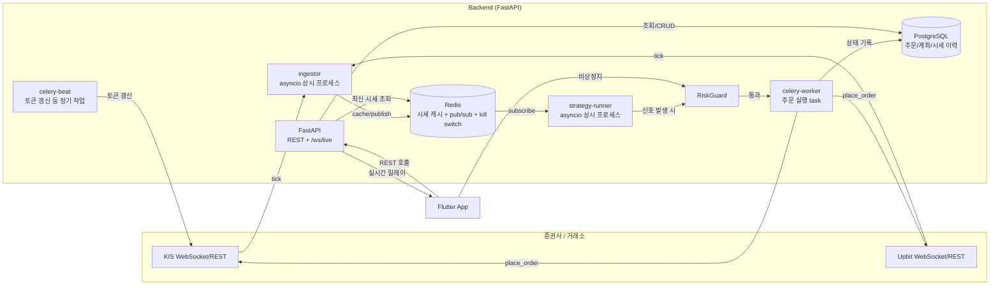

# QuantPilot 아키텍처

시장을 실시간 감시하고 설정한 전략에 따라 자동으로 매매를 실행하는 개인용 자산 관리 앱.

## 1. 전제 조건

- 단일 사용자 프로젝트 (다중 테넌트 SaaS 아님) — 인증은 앱 접근 제어 수준으로 단순화
- 1차 연동 브로커: 한국투자증권 KIS Developers (국내 주식, REST + WebSocket)
- 2차 연동 예정: Upbit (코인, REST + 공개 WebSocket) — 이를 위해 브로커 계층을 자산군 공용 인터페이스로 설계
- Task Queue: Celery + Redis
- 배포: 로컬 Docker Compose (클라우드 배포는 이후 단계)

## 2. 시스템 구성도



## 3. 프로세스 분리 이유

| 프로세스 | 특성 | Celery로 하지 않는 이유 |
|---|---|---|
| `ingestor` | 장시간 유지되는 WebSocket 연결 | Celery task는 짧은 실행 단위에 최적화, 상시 연결에는 부적합 |
| `strategy-runner` | Redis pub/sub을 구독하는 반응형 루프 | 동일하게 상시 실행이 필요, 폴링 대신 이벤트 기반으로 지연 최소화 |
| `celery-worker` | 주문 제출/취소 — 부수효과 + 재시도/멱등성 필요 | Celery의 재시도·큐잉이 정확히 이 용도에 맞음 |
| `celery-beat` | KIS 토큰 갱신, 정산 등 정기 작업 | 스케줄링이 핵심 요구사항 |

`docker-compose.yml`에 다섯 개 서비스(api, ingestor, strategy-runner, celery-worker, celery-beat) + postgres + redis로 정의되어 있다.

## 4. 데이터 흐름

1. **시세 수집**: `ingestor`가 KIS/Upbit WebSocket을 구독해 틱을 수신 → `market_data/cache.py`를 통해 Redis에 `price:{asset_class}:{symbol}` 키로 캐싱하고 동일 채널에 publish
2. **전략 평가**: `strategy-runner`가 Redis pub/sub을 구독 → 틱이 들어올 때마다 해당 심볼을 감시하는 활성 전략만 `strategy/engine.py`로 평가 (이동평균 교차, 가격 임계값 등 규칙 기반)
3. **리스크 체크**: 신호가 발생하면 주문 제출 전 반드시 `risk/guard.py`의 `RiskGuard`를 통과 — kill switch 확인, 포지션 한도, 손절 조건 체크
4. **주문 실행**: 통과한 신호는 `trading/tasks.py`의 Celery task로 위임 → `broker/factory.py`가 `TRADING_MODE`(paper/live)에 따라 KIS 또는 Upbit 어댑터를 선택해 실제 주문 API 호출 → 결과를 `orders` 테이블에 기록
5. **클라이언트 갱신**: FastAPI가 `/ws/live`로 시세/주문 상태 변경을 Flutter 앱에 릴레이 (KIS/Upbit WebSocket과는 별개의, 백엔드가 팬아웃하는 채널)
6. **이력 저장**: 주문/체결 이력은 PostgreSQL `orders` 테이블에 저장. 시세 캔들은 `candles` 모델만 있고 아직 저장하지 않는다 — 백테스트 설계([`docs/backtest-design.md`](./docs/backtest-design.md))에서 함께 다룬다 (대용량화 시 TimescaleDB 확장 도입 권장)

## 5. 안전장치 설계

- **모의/실전 분리**: `TRADING_MODE` 환경변수(paper/live)가 유일한 스위치이며 `broker/factory.py` 한 곳에서만 분기한다. KIS는 모의투자 전용 서버·자격증명이 별도로 존재하고, Upbit은 모의투자 서버가 없어 `paper` 모드에서는 실제 API 호출을 막는다 (`broker/upbit/client.py`의 `_require_live`). 시뮬레이션 체결 경로는 아직 없으므로, `paper` 모드의 전략 러너는 CRYPTO 전략을 아예 평가하지 않고 기동 시 경고 로그를 남긴다 (`strategy/runner.py`의 `_runnable_asset_classes`).
- **비상 정지(kill switch)**: Redis의 `kill_switch:global` 키 하나로 전체 신규 주문을 즉시 차단. 앱 대시보드에 상시 노출되는 버튼 → `POST /risk/kill-switch/engage` → 이후 모든 주문 경로(`RiskGuard.assert_can_trade`)가 이 값을 먼저 확인한다. 이미 브로커에 접수된 미체결 주문은 `poll_pending_order_fills`(celery-beat 10초 주기)가 kill switch가 켜져 있는 동안 취소한다. API로 켜면 이 작업을 즉시 한 번 실행시키고, 일일 손실 한도로 자동 발동되면 다음 주기에 처리된다. 취소 직후 체결 상태를 다시 조회해, 취소 직전에 체결된 수량도 포지션/손익에 반영한다. `KILL_SWITCH_DEFAULT=true`면 API와 전략 러너가 기동할 때마다 kill switch를 켠 상태로 시작한다(이미 켜져 있으면 그대로 둔다).
- **손절/포지션 한도**: 전략별 `stop_loss_pct`, `max_position_size`를 `RiskGuard.check_stop_loss` / `check_position_size`에서 체크, 초과 시 `RiskLimitExceededError`로 주문을 거부하고 감사 로그를 남긴다. 포지션 한도는 주문 직전에 다시 읽은 실제 보유 수량(`positions` 테이블) + 이번 주문 수량 기준이다.
- **일일 손실 한도**: 전략별 손절과는 별개로, 계좌 전체 기준 상위 서킷브레이커. 매도 체결마다 실현손익을 `DailyPnlRepository`(Redis, KST 날짜 기준 자동 리셋)에 누적하고, `DAILY_LOSS_LIMIT_KRW`를 넘으면 `RiskGuard`가 kill switch를 자동 발동한다 — 그 뒤로는 기존 kill switch 경로가 모든 신규 주문을 그대로 차단한다.
- **Kill switch 감사 로그**: kill switch on/off 상태 자체는 Redis(`KillSwitchRepository`)에 있지만, "언제 왜 발동됐는지"는 별도로 Postgres(`KillSwitchAuditLogRepository`)에 영구 기록한다 — 알림을 놓쳐도 나중에 이력을 되짚어볼 수 있다.
- **중복 주문 방지 (멱등성과 대사)**: 주문마다 `client_order_id`를 미리 발급하고(`Order.client_order_id` unique), Celery 재시도는 같은 주문 레코드를 다시 찾는다. 다만 이 키가 브로커까지 전달되는지는 브로커마다 다르다. Upbit은 `identifier`로 함께 보내지만, KIS 국내주식 주문 API에는 그런 필드가 없다. 그래서 "보냈는데 결과를 모르는" 경우를 상태로 따로 관리한다 (`trading/facade.py`).
  - `pending`: 브로커에 접수되지 않은 것이 확실한 상태. 같은 `client_order_id`로 다시 보내도 된다.
  - `unknown`(미확정): 브로커로 보내기 직전에 먼저 이 상태로 저장한다. 응답을 받으면 결과 상태로 바꾸고, 브로커가 명시적으로 거부했거나 전송 전에 실패했으면(`BrokerAPIError`) `pending`으로 되돌린다. 응답 유실(읽기 타임아웃, 연결 끊김, 응답 파싱 실패, 주문번호 없는 성공 응답 → `OrderOutcomeUnknownError`)이나 전송 도중 워커 종료 시에는 `unknown`으로 남는다.
  - `unknown` 주문은 Celery가 재시도하지 않고(`OrderOutcomeUnknownError`는 `BrokerAPIError`가 아님), 전략 러너도 그 종목에 새 주문을 내지 않는다(`has_open_order`). `poll_pending_order_fills`가 `BrokerAdapter.find_order`로 대사한다. 브로커에서 찾으면 그 주문을 이어받아 일반 체결 폴링 대상이 되고, 2분이 지나도 접수 기록이 없으면 `rejected`로 확정한다(이후 다음 신호에서만 새 주문). 후보가 여러 건이거나 조회가 실패하면 `unknown`을 유지하고, 사람이 확인할 때까지 그 종목은 막힌다.
  - KIS 대사는 당일 주문체결조회(`inquire-daily-ccld`)에서 종목, 매수/매도, 수량, 주문시각으로 찾고, 이미 다른 주문에 연결된 주문번호는 뺀다. 같은 조건의 수동 주문(HTS 등)과 구분하지 못할 수 있고, 응답 필드명은 문서 기준이라 모의투자 계좌로 검증해야 한다. Upbit은 `identifier`로 정확히 조회한다.
- **자격증명 분리**: `.env`에서 paper/live 앱키·시크릿을 완전히 분리된 변수로 관리해, live 자격증명이 실수로 paper 경로에 쓰이는 것을 원천 차단한다.

## 6. 헥사고날 아키텍처 (포트 & 어댑터)

`broker/`(base.py=포트, kis/·upbit/=어댑터)의 패턴을 모든 feature에 동일하게 적용한다.

- **`ports.py`**: 해당 feature의 서비스/도메인 로직이 의존하는 추상 인터페이스(ABC). 저장소가
  DB인지 Redis인지, 알림 채널이 무엇인지 등은 여기서 드러나지 않는다.
- **어댑터** (`repository.py`, `redis_repository.py`, `redis_cache.py`, `ws_channel.py` 등):
  포트를 구체 인프라(SQLAlchemy, Redis, WebSocket)로 구현한다. 인프라를 교체하거나
  테스트용 in-memory 구현체로 바꿔도 이 파일들만 손대면 된다.
- **`service.py`**: 애플리케이션 서비스. 생성자로 포트를 주입받아 오케스트레이션만 담당하고,
  구체 어댑터를 직접 import하지 않는다.
- **조립 지점**: `router.py`(또는 `factory.py`)가 유일하게 구체 어댑터를 선택해 서비스에
  주입한다 — `get_<feature>_service()` 형태의 FastAPI dependency 함수가 그 역할을 한다.

적용 범위: `account`, `risk`, `notification`, `strategy`, `trading`, `market_data`.
`strategy/engine.py`처럼 순수 함수로만 이루어진 도메인 로직은 애초에 인프라 의존성이
없어 포트가 필요 없다.

## 7. 폴더 구조 요약

```
QuantPilot/
├── ARCHITECTURE.md
├── docker-compose.yml
├── .env.example
├── backend/                        # FastAPI, Package by Feature + 헥사고날(포트/어댑터)
│   ├── app/
│   │   ├── core/                   # config, security(JWT), deps(인증 dependency), logging, exceptions
│   │   ├── db/                     # SQLAlchemy base/session, Redis client
│   │   ├── ws/                     # Flutter 앱으로의 실시간 릴레이(WS)
│   │   └── features/
│   │       ├── account/            # ports.py, repository.py(어댑터), service.py, router.py(조립)
│   │       ├── broker/             # 자산군 공용 어댑터 인터페이스(포트) + kis/, upbit/(어댑터) — 기준 패턴
│   │       ├── market_data/        # ports.py, redis_cache.py(어댑터), factory.py(조립), ingestor(상시 프로세스)
│   │       ├── strategy/           # ports.py, repository.py, service.py, engine.py(순수 도메인), runner(상시 프로세스)
│   │       ├── trading/            # ports.py(Order/Position), repository.py, service.py, Celery task
│   │       ├── risk/               # ports.py(KillSwitchRepository), redis_repository.py, guard.py
│   │       └── notification/       # ports.py(NotificationChannel), ws_channel.py, factory.py
│   ├── scripts/                    # 일회성 운영 스크립트 (create_user.py 등)
│   ├── alembic/                    # DB 마이그레이션
│   └── tests/
└── frontend/                       # Flutter
    └── lib/
        ├── core/                   # network(Dio/WS 클라이언트), theme, di(Riverpod), constants
        └── features/               # dashboard, market_watch, strategy, orders, account, settings
            └── {feature}/{data,domain,presentation}/
```

## 8. 다음 단계 후보

- Upbit 실제 REST·WS 연동 구현 (KIS는 체결 확인 폴링까지 완료)
- 전략 엔진 규칙 타입 확장 (RSI, 볼린저밴드 등) 및 백테스트 모듈 (설계: [`docs/backtest-design.md`](./docs/backtest-design.md))
- 알림 채널 확장 (푸시 알림, 이메일)
- 시계열 데이터 규모가 커지면 TimescaleDB 도입 검토
- 클라우드 인프라 구성 및 배포 자동화(CD)
