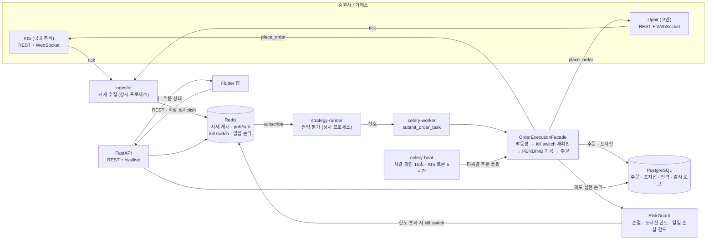

# QuantPilot

설정한 전략대로 자동으로 사고파는 **1인용** 자동매매 앱입니다. 실시간 시세에 맞춰 전략이 매수, 매도를 판단하고, 주문부터 체결 확인, 손익 반영까지 사람 손 없이 이어집니다. 백엔드는 Python FastAPI, 앱은 Flutter입니다. 다중 테넌트 SaaS가 아니라 1인 사용자 기준으로 설계했습니다.

- 포트폴리오 상세: https://ji-geunyeong.kro.kr/projects/quantpilot
- 블로그: [QuantPilot: 주문 직전 재확인과 일일 손실 한도로 자동매매 지키기](https://velog.io/@codes-gy/QuantPilot-주문-직전-재확인과-일일-손실-한도로-자동매매-지키기)
- 설계 문서: [`ARCHITECTURE.md`](./ARCHITECTURE.md) · 백엔드: [`backend/`](./backend) · 앱: [`frontend/`](./frontend) ([`frontend/PLANNING.md`](./frontend/PLANNING.md)) · 서버 배포: [`deploy/README.md`](./deploy/README.md)

> **실제 돈이 오가는 프로그램입니다.** 기본값은 모의투자(`TRADING_MODE=paper`)이며, `.env.example`에도 "기본값은 반드시 paper로 유지할 것"이라고 적혀 있습니다. 실전(`live`)으로 바꾸기 전에 아래 [안전장치](#안전장치)를 먼저 읽으세요. 같은 API 키로 PC와 서버에서 동시에 돌리면 주문이 두 번 나갑니다([`deploy/README.md`](./deploy/README.md)).

## 문제 해결 사례

### 1. 주문이 나가기 직전까지 다시 확인 — 실행 파이프라인

- **문제**: 전략이 주문을 판단한 시점과 실제로 나가는 시점 사이에 비상 정지가 걸리거나, 재시도 때문에 같은 주문이 두 번 나갈 수 있었습니다.
- **원인**: 신호 평가(`strategy-runner`)와 주문 실행(Celery task)이 다른 프로세스에서 따로 일어나고, 증권사 오류 시 Celery가 같은 작업을 재시도합니다.
- **해결**: 주문 실행을 한 곳([`OrderExecutionFacade`](./backend/app/features/trading/facade.py))으로 모아 ① `client_order_id`로 이미 처리한 주문인지 확인 ② 실행 직전 비상 정지 재확인 ③ 증권사 호출 전에 `PENDING` 주문을 먼저 기록 ④ 결과 반영 ⑤ 매수는 평균 단가, 매도는 실현 손익으로 정산하는 순서로 처리합니다. 증권사 오류(`BrokerAPIError`)만 최대 3번 재시도하고([`trading/tasks.py`](./backend/app/features/trading/tasks.py)), 리스크 오류는 재시도하지 않습니다.
- **결과**: 실행 시점 기준으로 비상 정지를 지키고, 재시도해도 같은 주문 ID로 주문을 다시 만들지 않습니다. [`test_order_execution_facade.py`](./backend/tests/features/test_order_execution_facade.py)(12개)로 확인합니다.

### 2. 손실이 쌓이면 스스로 멈추기 — 일일 손실 한도

- **문제**: 자동매매는 사람이 보지 않는 동안에도 손실이 계속 쌓일 수 있습니다.
- **해결**: 매도 체결마다 실현 손익을 Redis에 한국 날짜별로 누적(`INCRBYFLOAT`, [`risk/redis_repository.py`](./backend/app/features/risk/redis_repository.py))하고, `DAILY_LOSS_LIMIT_KRW`를 넘으면 [`RiskGuard`](./backend/app/features/risk/guard.py)가 비상 정지를 자동으로 걸어 신규 주문을 막습니다. 발동 사유는 Postgres 감사 로그 테이블에 남기고(`GET /api/v1/risk/kill-switch/history`), 앱에서 해제와 이력 조회를 할 수 있습니다. Redis는 AOF로 디스크에 저장해, 재시작만으로 비상 정지가 풀리거나 오늘 손익이 0으로 돌아가지 않게 했습니다([`docker-compose.yml`](./docker-compose.yml)).
- **결과**: 하루 손실이 한도에 닿는 순간부터 신규 주문이 나가지 않습니다. [`test_risk_guard.py`](./backend/tests/features/test_risk_guard.py)(14개)로 확인합니다.

## 아키텍처



흐름: 시세 수신 → 전략 판단(이동평균 교차, 가격 기준, [`strategy/engine.py`](./backend/app/features/strategy/engine.py)) → 주문 먼저 기록(`PENDING`) → 증권사 호출 → 체결 반영(평균 단가, 실현 손익) → 일일 손실 누적. 자세한 데이터 흐름은 [`ARCHITECTURE.md`](./ARCHITECTURE.md) 4절에 있습니다.

**구조**: 기능마다 `ports.py`(인터페이스)를 두고 DB, Redis, 증권사는 어댑터로 붙이는 포트 & 어댑터(헥사고날) 구조입니다. 그래서 `RiskGuard`와 `OrderExecutionFacade`는 테스트에서 메모리 가짜 구현으로 바꿔 끼웁니다([`ARCHITECTURE.md`](./ARCHITECTURE.md) 6절).

## 기술 스택과 고른 이유

| 영역 | 사용 | 이유 (ARCHITECTURE.md, docker-compose.yml 기준) |
|---|---|---|
| 백엔드 | Python 3.12, FastAPI, SQLAlchemy(async), Alembic, PostgreSQL, JWT(pyjwt) + passlib | |
| 주문 실행 | Celery + Redis | 주문 제출은 부수효과가 있어 재시도, 큐잉, 멱등성이 필요하고 Celery의 재시도가 이 용도에 맞습니다. |
| 시세 수집, 전략 평가 | asyncio 상시 프로세스 (`ingestor`, `strategy-runner`) | Celery task는 짧은 실행 단위에 맞춰져 있어 장시간 WebSocket 연결에 맞지 않아 쓰지 않았습니다. 전략은 폴링 대신 Redis pub/sub 이벤트로 받아 지연을 줄입니다. |
| 정기 작업 | celery-beat | KIS 토큰 갱신, 체결 확인처럼 스케줄이 핵심인 작업 |
| 상태 저장 | Redis (AOF) | 비상 정지, 오늘 손익을 재시작 후에도 유지하려고 디스크에 저장합니다. |
| 앱 | Flutter, Riverpod(상태 관리/DI), Dio(REST), WebSocket, fl_chart | |
| 증권사 | 한국투자증권 KIS Developers(국내 주식), Upbit(코인) | 브로커 계층을 자산군 공용 인터페이스(`broker/base.py`)로 설계해 거래소를 추가할 수 있게 했습니다. |
| 인프라 | Docker Compose (api, ingestor, strategy-runner, celery-worker, celery-beat, postgres, redis) | 로컬 실행. 1GB 서버용 운영 구성은 `docker-compose.prod.yml` |

## 안전장치

- **모의/실전 분리**: `TRADING_MODE`(paper/live) 하나로만 전환하고, [`broker/factory.py`](./backend/app/features/broker/factory.py) 한 곳에서만 분기합니다. paper와 live 자격증명은 `.env`에서 서로 다른 변수(`KIS_PAPER_*`, `KIS_LIVE_*`)로 관리합니다.
- **실전 모드 기동 차단**: `TRADING_MODE=live`인데 `SECRET_KEY`가 기본값이거나 `KIS_LIVE_*` 설정이 하나라도 비어 있으면 API 서버가 아예 켜지지 않습니다([`core/config.py`](./backend/app/core/config.py)의 `assert_safe_to_start`).
- **Upbit**: 모의투자 서버가 없어, paper 모드에서는 Upbit 주문 API를 호출하지 않습니다(`broker/upbit/client.py`의 `_require_live`).
- **비상 정지(kill switch)**: 앱 버튼 한 번으로 모든 신규 주문을 즉시 차단합니다(Redis `kill_switch:global`). 주문 실행 직전에 다시 확인합니다.
- **손절/포지션 한도**: 전략별 `stop_loss_pct`, `max_position_size`를 `RiskGuard`가 주문 전에 확인합니다.
- **중복 주문 방지**: `client_order_id` unique 제약, 미체결 주문이 있으면 신호 무시, 매수/매도별 쿨다운과 손절 후 즉시 재매수 방지([`strategy/submit_guard.py`](./backend/app/features/strategy/submit_guard.py)).
- **포트 바인딩**: Postgres, Redis(인증 없음), API는 `127.0.0.1`에만 열립니다([`docker-compose.yml`](./docker-compose.yml)).

## 실행 방법

### 1. 환경 변수

```bash
cp .env.example .env   # KIS/Upbit 자격증명 등 채워넣기 (아직 없다면 비워둬도 paper 이전 개발은 가능)
```

`.env.example`에 있는 이름: `SECRET_KEY`, `DATABASE_URL`, `REDIS_URL`, `CELERY_BROKER_URL`, `CELERY_RESULT_BACKEND`, `TRADING_MODE`, `KILL_SWITCH_DEFAULT`, `DAILY_LOSS_LIMIT_KRW`(비우면 비활성화), `KIS_PAPER_APP_KEY` / `KIS_PAPER_APP_SECRET` / `KIS_PAPER_ACCOUNT_NO`(모의투자 신청 후 발급), `KIS_LIVE_*`(live로 바꾸기 전까지 비워 둬도 됨), `UPBIT_ACCESS_KEY` / `UPBIT_SECRET_KEY`.

### 2. 백엔드 (Docker Compose)

```bash
docker compose up --build
docker compose exec api alembic upgrade head                        # 최초 실행 시 마이그레이션
docker compose exec api python -m scripts.create_user user@example.com   # 최초 계정 (공개 회원가입 없음)
```

- API: http://localhost:8000 (`/health`로 상태 확인, `/docs`에서 API 문서)
- `/auth/login`으로 받은 JWT를 `Authorization: Bearer <token>`으로 보냅니다. `/ws/live`는 `?token=<access_token>`을 씁니다. 자세한 내용은 [`backend/README.md`](./backend/README.md).

### 3. 앱 (Flutter)

```bash
cd frontend
flutter pub get
flutter run --dart-define=API_BASE_URL=http://localhost:8000/api/v1 --dart-define=WS_URL=ws://localhost:8000/ws/live
```

### 4. 서버 배포 (선택)

메모리 1GB 서버에서는 빌드하지 않고, GitHub Actions가 ghcr.io에 올린 이미지를 받아 `docker-compose.prod.yml`로 실행합니다. API는 서버의 127.0.0.1에만 열고 SSH 터널로 접속합니다. 절차는 [`deploy/README.md`](./deploy/README.md)에 있습니다.

## 테스트

```bash
cd backend
python -m venv .venv && source .venv/bin/activate
pip install -r requirements.txt
pytest -v
```

DB/Redis 없이도 통과합니다(`RiskGuard`, `OrderExecutionFacade`는 포트 인터페이스에만 의존해, 테스트에서는 메모리 fake로 바꿉니다). Docker로 띄운 상태라면 `docker compose exec api pytest`도 됩니다.

2026-11-25 기준 [`backend/tests/`](./backend/tests)의 테스트 함수는 77개이고, `parametrize` 케이스를 펼치면 pytest가 85개를 실행합니다(포트폴리오에 적은 "PR #3 실행 기준 85개 통과"와 같은 수).

| 파일 | 함수 수 | 다루는 것 |
|---|---|---|
| `features/test_upbit_client.py` | 18 | Upbit 주문, 서명, paper 모드 미호출, 같은 주문 ID 재시도 |
| `features/test_risk_guard.py` | 14 | 비상 정지, 손절, 포지션 한도, 일일 손실 한도 |
| `features/test_order_execution_facade.py` | 12 | 멱등성, 실행 직전 재확인, 체결 반영, 평균 단가, 실현 손익 |
| `features/test_strategy_service.py` | 10 (+8 parametrize) | 잘못된 전략 켜기 거부 |
| `features/test_submit_guard.py` | 5 | 방향별 쿨다운, 손절 후 즉시 재매수 방지 |
| `features/test_symbol_search.py` | 5 | 종목 검색 |
| `features/test_kis_quote.py` | 4 | KIS 현재가 |
| `core/test_config.py` | 4 | 실전 모드 기동 차단 |
| `features/test_strategy_engine.py`, `test_trading_service.py` | 2, 2 | 전략 판단, 포지션 조회 |
| `core/test_security.py` | 1 | 비밀번호 해시 |

앱은 `frontend/test/`에 위젯 테스트 21개(`testWidgets`/`test` 호출 수, 전략 등록, 수정/삭제, 켜기/끄기 등)가 있습니다.

CI(GitHub Actions): 백엔드는 `backend/` 변경 시 ruff 검사, 앱 import 확인, pytest([`backend-ci.yaml`](./.github/workflows/backend-ci.yaml)), 앱은 `flutter analyze`, `flutter test`([`frontend-ci.yaml`](./.github/workflows/frontend-ci.yaml))를 돌립니다. main에 백엔드가 바뀌면 운영 이미지를 빌드합니다([`backend-image.yaml`](./.github/workflows/backend-image.yaml)).

## 폴더 구조

```text
backend/app/
  core/          설정(실전 모드 차단), JWT, 인증 dependency
  features/
    broker/      자산군 공용 인터페이스 + kis/, upbit/ 어댑터, factory.py(paper/live 분기)
    market_data/ 시세 수집기(ingestor), Redis 캐시
    strategy/    engine.py(순수 규칙), runner.py(상시 평가), submit_guard.py
    trading/     facade.py(주문 실행), tasks.py(Celery)
    risk/        guard.py, 비상 정지, 일일 손익
    account/, notification/
  ws/            앱으로 보내는 실시간 채널
backend/tests/   pytest
frontend/lib/    core/ + features/{dashboard,market_watch,strategy,orders,account,settings}
deploy/          1GB 서버 설정, 배포 스크립트
```

## 진행 현황

| 단계 | 내용 | 상태 |
|---|---|---|
| 인증 | JWT 기반 라우터 보호, CLI 계정 생성(`scripts/create_user.py`) | 완료 |
| 주문 실행 파이프라인 | `OrderExecutionFacade` — 리스크 재확인/멱등성/브로커 호출/포지션 갱신 | 완료 |
| 전략 러너 | 활성 전략 동적 로드, 손절/포지션 한도 실연결 | 완료 |
| KIS 실연동 | 인증, 주문, 실시간 시세 WebSocket, 체결 확인 폴링 | 구현 (모의투자 앱키로 실제 검증 필요) |
| Upbit 실연동 | 인증, 주문, 실시간 시세 WebSocket (커밋 c416e18) | 구현 (live 모드 전용) |
| 일일 손실 한도, 감사 로그 | 위 사례 2 | 완료 |
| Live 모드 안전장치 | 기본 시크릿/빈 KIS 자격증명이면 기동 거부 | 완료 |
| CI | 백엔드 ruff + import 확인 + pytest, 앱 analyze + test | 완료 |

## 한계와 다음 단계

- KIS 연동은 모의투자 앱키로 실제 검증이 필요합니다(위 표).
- Upbit은 모의투자 서버가 없어 paper 모드에서는 코인 주문을 보내지 않습니다.
- 전략 규칙은 이동평균 교차와 가격 기준뿐입니다. RSI, 볼린저밴드 같은 규칙과 백테스트 모듈은 아직 없습니다.
- 알림은 앱 WebSocket 채널뿐입니다. 푸시 알림, 이메일은 아직 없습니다.
- 시계열 데이터가 커지면 TimescaleDB 도입을 검토합니다.
- 서버 반영은 `deploy/deploy.sh`를 직접 실행합니다(이미지 빌드만 자동).
- 이 목록은 [`ARCHITECTURE.md`](./ARCHITECTURE.md) 8절을 바탕으로, 이미 끝난 항목(Upbit 연동, 앱 CI)은 뺐습니다.
